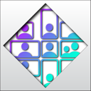
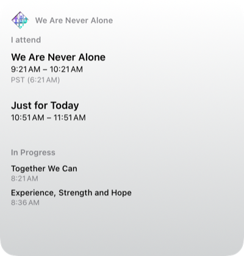
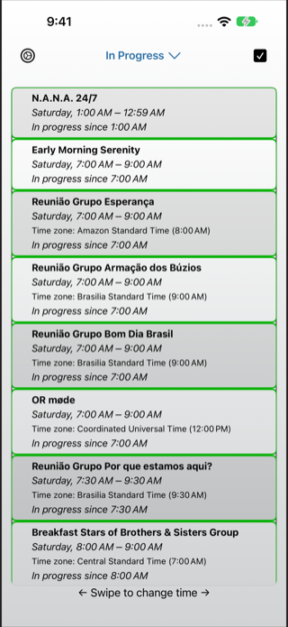
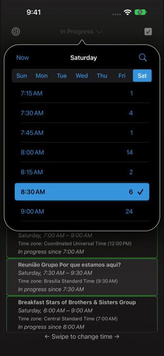
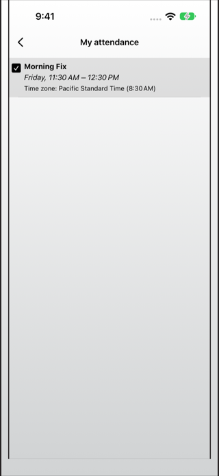
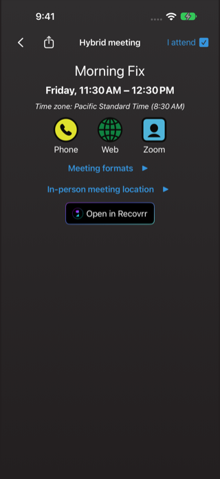
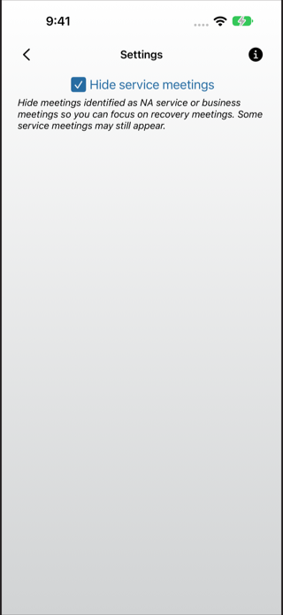
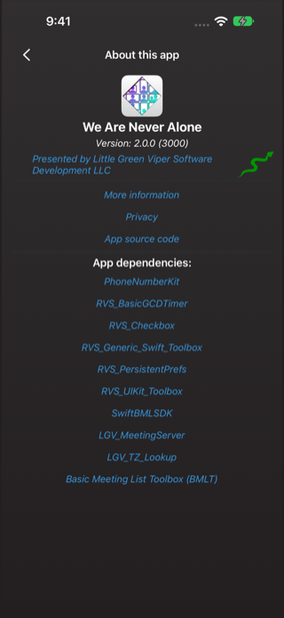

#  We Are Never Alone

**Version 2.0.0** — Discover and attend virtual and hybrid Narcotics Anonymous meetings in your local time zone.

## Overview

We Are Never Alone brings a worldwide meeting directory to iPhone, iPad, and compatible Macs running the iPhone/iPad app. Find a meeting in progress, browse by day and time, search meeting names, and keep the meetings you attend close at hand.

Version 2.0.0 introduces refreshed app and splash artwork, light and dark backgrounds, a day/time and search popover, and Home Screen widgets. Greek and Latin American Spanish join the existing translations, with terminology aligned with Recovrr.

The app is free on the Apple App Store.

[](https://apps.apple.com/us/app/we-are-never-alone/id6504826025)

See [CHANGELOG.md](CHANGELOG.md) for the version history.

## Usage

The app uses [`SwiftBMLSDK`](https://github.com/LittleGreenViper/SwiftBMLSDK) to download virtual and hybrid meetings from [`LGV_MeetingServer`](https://github.com/LittleGreenViper/LGV_MeetingServer). It loads the directory when needed at startup, checks for a refresh after four hours away, and supports pull-to-refresh outside name search.

It then converts meeting start and end times to the user's current timezone. Select the weekday and time in the navigation bar to open the day/time popover. Choose a weekday to see its available meeting start times, then tap a time to display those meetings and close the popover. The time list scrolls when needed. **Now** shows meetings in progress, and the search button opens the meeting-name field inside the popover and filters the main table as you type. Select **Show results**, use the keyboard’s Search key, or dismiss the popover to view the results; reopening it preserves your query. Search ignores case, accents, character-width differences, and equivalent Latin glyphs such as ligatures.

Select a meeting to inspect its schedule, formats, joining details, and any in-person location. Supported installed meeting apps can open directly from the inspector. Web and phone options depend on the connection details supplied by the meeting.

Mark **I attend** to add a meeting to your attendance list and widget. The inspector's share sheet can share a meeting link, prepare a weekly calendar event for review, or open an available map app. A separate **Open in Recovrr** button appears when Recovrr is available.

### Home Screen widget



Add **Meetings** from the We Are Never Alone widget gallery. Medium shows the next meeting marked **I attend**, including a meeting already in progress. Large and extra-large show attended meetings first, then meetings in progress, followed by upcoming meetings when space permits. Extra-large sizes are offered where the device and OS support them. The widget shares the app’s splash logo and uses the same adaptive system background as Recovrr’s widgets. The attendance heading is **My Next Meeting**. In **Edit Widget**, each large widget offers **Only show meetings that I attend.**, off by default. Turning it on fills the available list space with attended meetings and hides the in-progress and upcoming sections. This setting applies only to the large size; when there are no attended meetings, only **Off** is available and the normal lists appear.

Tap an attended, in-progress, or upcoming meeting to open its inspector directly in the app. This works on startup and when the app is already open on another screen. Links wait for the initial meeting download when needed. With no attended meetings, medium shows only a larger centered splash logo. Large and extra-large center the logo in the header and show in-progress and upcoming meetings below it. Tap the centered logo to open the main meeting screen.

All primary times use the member's current timezone and locale. Attended meetings include a start–end span and, when their timezone differs, the source timezone and native start time. The widget honors the service-meeting filter and avoids repeating displayed attended meetings in the other sections.

The app publishes its downloaded meeting collection and preferences to an on-device App Group. SwiftBMLSDK resolves eight upcoming occurrences per meeting, including DST, before dates reach the widget. The widget selects and formats these absolute dates; it does not calculate recurrences, apply offsets, or make its own meeting requests. Opening or refreshing the app renews the schedule; attendance and filter changes request a widget update. WidgetKit controls update timing. The centered icon also appears before the first download and when the cached dates run out.

For device signing, enable the **App Groups** capability on both **We Are Never Alone** and **VMFWidgets**, using `group.org.littlegreenviper.VMF`. Both entitlement files already declare this group; the signing team must register it and include it in both provisioning profiles. The app target embeds the extension automatically. Keep the two targets' version/build numbers in sync. Both targets use the same artwork in `Sources/Shared/LaunchArtwork.xcassets`.

Widget regression tests are included in the regular scheme's Test action. They cover service filtering, list priority, meeting boundaries, local formatting, and SDK date export across DST and midnight.

## The Screens

### The Main Screen



The main screen starts with meetings in progress. The navigation title shows the selected weekday and time, or the current search/Now mode. Its popover contains the weekday selector, the available start times and meeting counts, Now, and search. Weekdays follow the user's local calendar order.



Swiping the meeting list moves between time slots. From Now, the first forward swipe opens the first available start after the current local time; the first backward swipe opens the latest start at or before now. Further swipes move through adjacent start times, skipping days without meetings. Paging is disabled during name search.

### The Attendance Screen



After you mark one or more meetings **I attend**, the attendance button on the main screen opens your saved list. Meetings in progress appear first, followed by the next upcoming occurrences. Attendance stays on your device and does not synchronize with other devices.

### The Meeting Inspector Screen



Select a meeting from any list to see its details. Expand formats or the in-person location, use the available joining controls, change attendance, share the meeting, or prepare a calendar event. Times are shown in your local time zone, with source time-zone information when it differs.

### The Settings Screen



Open Settings from the main screen to choose whether recognized service meetings are hidden from day/time and name-search results. The widget also honors this preference. Settings links to the About screen.

### The About This App Screen



About shows the installed version and build, the app's artwork, publisher information, privacy and source links, and its dependencies. The icon changes with light and dark appearance.

## Screenshots

For App Store screenshots, run **We Are Never Alone (For Screenshots)** on all three designated simulators: **Screenshot 0 (\*)**, **Screenshot 1 (\*)**, and **Screenshot 2 (\*)**. Capture a complete set for each App Store localization in the order listed below, alternating light and dark appearance between consecutive screenshots in each set.

Keep finished screenshots in `/Volumes/RedT5/We Are Never Alone Screenshots/`. Keep drafts, previews, temporary captures, and screenshot build output (including DerivedData) in a separate working directory on `/Volumes/RedT5/`.

The Screenshots configuration displays the supported virtual-meeting app control for the meeting's connection URL, even when that app is not installed, and displays Open in Recovrr. These controls are for screenshot presentation; the simulator does not gain cameras or installed apps.

Archiving is disabled in the scheme, and a build guard rejects archive/install actions using the Screenshots configuration. Regular Debug and Release builds retain their normal availability checks.

## Localization

The app and widget support English, French, German, Greek, Italian, Brazilian Portuguese, Spanish (Spain), and Latin American Spanish. Dates, times, and weekday order follow the user's locale; meeting names stay in their source language. VoiceOver labels, hints, and meeting-row attendance actions are localized alongside visible text.

For version 2.0.0 and later, App Store localizations use this order:

1. English (U.S.), the primary localization
2. French
3. German
4. Greek
5. Italian
6. Portuguese (Brazil)
7. Spanish (Spain)

App text, alerts, and VoiceOver labels and hints share `Localizable.strings` in each language’s resource folder. The app’s `String.localizedVariant` accessor uses RVS_Generic_Swift_Toolbox to check Accessibility, Errors, and Localizable, then falls back to the shared NonLocalized table.

`Resources/NonLocalized.strings` holds shared product names, URLs, and universal-link formats in one nonlocalized resource. This includes the six `SLUG-DIRECT-URI-*` app-name keys supplied dynamically by SwiftBMLSDK; retain these even though they have no literal callers in app source. Callers use `String.localizedVariant` for both shared values and translated text, without choosing a table. Keep this table out of the language-specific folders and translation work.

`InfoPlist.strings` remains separate because iOS reads the app display name and calendar permission prompts from that table. Use plain language consistent with Recovrr and local NA terminology. Preserve format placeholders, product names, and URLs. Weekday names are supplied by Foundation; avoid adding language-specific plural endings to them.

The widget uses `Sources/VMFWidgets/Localizable.xcstrings` and `InfoPlist.xcstrings` for the same eight languages, including its header, gallery description, accessibility hints, and extension display name. Attendance and in-progress labels match the app's terminology. Meeting names remain in their source language; dates and timezone names use the widget's current locale. Regression tests check every compiled widget translation and compare its app name and attendance label with the corresponding app localization.

## Building Documentation

Select the **We Are Never Alone** scheme and an iOS simulator in Xcode, then choose **Product > Build Documentation**. The app target includes internal symbols so the catalog covers its controllers and support types. The catalog contains guides to architecture, documentation builds, accessibility, and localization.

For a command-line build from the repository root:

```sh
xcodebuild docbuild -project VirtualMeetingFinder.xcodeproj \
  -scheme 'We Are Never Alone' -configuration Debug \
  -destination 'generic/platform=iOS Simulator' \
  -derivedDataPath /tmp/VMFDocumentation CODE_SIGNING_ALLOWED=NO
```

Open `/tmp/VMFDocumentation/Build/Products/Debug-iphonesimulator/We Are Never Alone.doccarchive` in Xcode. The older generated site in `docs/` is separate from this DocC output.

## Dependencies

- [`RVS_BasicGCDTimer`](https://github.com/RiftValleySoftware/RVS_BasicGCDTimer)

- [`RVS_Checkbox`](https://github.com/RiftValleySoftware/RVS_Checkbox)

- [`RVS_Generic_Swift_Toolbox`](https://github.com/RiftValleySoftware/RVS_Generic_Swift_Toolbox)

- [`RVS_PersistentPrefs`](https://github.com/RiftValleySoftware/RVS_PersistentPrefs)

- [`RVS_UIKit_Toolbox`](https://github.com/RiftValleySoftware/RVS_UIKit_Toolbox)

- [`SwiftBMLSDK`](https://github.com/LittleGreenViper/SwiftBMLSDK)

- [`PhoneNumberKit`](https://github.com/PhoneNumberKit/PhoneNumberKit)

- [`LGV_MeetingServer`](https://github.com/LittleGreenViper/LGV_MeetingServer)

- [`LGV_TZ_Lookup`](https://github.com/LittleGreenViper/LGV_TZ_Lookup)

- [The Basic Meeting List Toolbox (BMLT)](https://bmlt.app)

## More Information

- [This is a page with a much more detailed explanation of the app.](https://littlegreenviper.com/the-virtual-na-meeting-finder-app/)

- [This is the internal Technical Documentation for the Project](https://littlegreenviper.github.io/VirtualMeetingFinder/)

## Privacy

[The Privacy Policy](https://littlegreenviper.com/the-virtual-na-meeting-finder-app#privacy)

This project collects **absolutely no information at all**, from anyone, at any time.

Attendance selections and settings stay on your device in [User Defaults](https://developer.apple.com/documentation/foundation/userdefaults). The app also writes a local meeting snapshot and a copy of these preferences to an App Group so its widget can display your schedule. Attendance does not synchronize with other devices. The widget uses that local snapshot and does not make its own meeting requests.

## Source Code

[The GitHub Repository with the Source Code for This App](https://github.com/LittleGreenViper/VirtualMeetingFinder)

## Presented By

[](https://littlegreenviper.com)

[Little Green Viper Software Development LLC](https://littlegreenviper.com)

## License

MIT License
 
Permission is hereby granted, free of charge, to any person obtaining a copy
of this software and associated documentation files (the "Software"), to deal
in the Software without restriction, including without limitation the rights
to use, copy, modify, merge, publish, distribute, sublicense, and/or sell
copies of the Software, and to permit persons to whom the Software is
furnished to do so, subject to the following conditions:

The above copyright notice and this permission notice shall be included in all
copies or substantial portions of the Software.

THE SOFTWARE IS PROVIDED "AS IS", WITHOUT WARRANTY OF ANY KIND, EXPRESS OR
IMPLIED, INCLUDING BUT NOT LIMITED TO THE WARRANTIES OF MERCHANTABILITY,
FITNESS FOR A PARTICULAR PURPOSE AND NONINFRINGEMENT. IN NO EVENT SHALL THE
AUTHORS OR COPYRIGHT HOLDERS BE LIABLE FOR ANY CLAIM, DAMAGES OR OTHER
LIABILITY, WHETHER IN AN ACTION OF CONTRACT, TORT OR OTHERWISE, ARISING FROM,
OUT OF OR IN CONNECTION WITH THE SOFTWARE OR THE USE OR OTHER DEALINGS IN THE
SOFTWARE.

